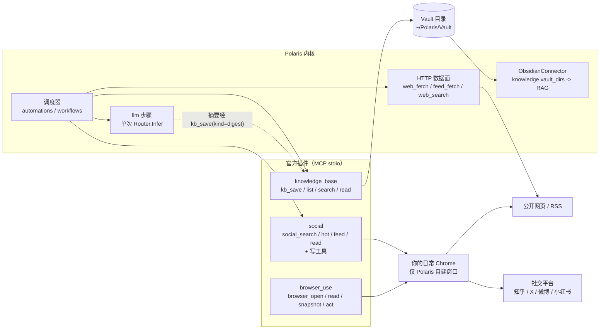
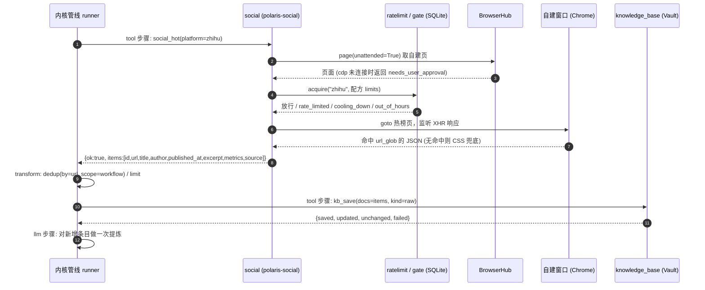

# 架构：分层、数据流与安全边界

本页说明三个插件与 Polaris 内核如何分工、数据怎样从网页流到 Vault 再进 RAG，以及哪些安全边界是写死在代码里的。

结论先行：**内核管 HTTP 数据面、调度与审批；插件管浏览器数据面、站点知识与落盘；LLM 只在管线最后做一次提炼。** 设计决策见 Polaris 仓库的 ADR-0114（`docs/arch/decisions/ADR-0114-info-acquisition-automation-pipeline.md`，决策四、决策八）。

## 1. 分层

| 层 | 谁负责 | 内容 |
|----|--------|------|
| 调度与编排 | 内核（`internal/automation`、workflows） | 定时触发、管线步骤（`tool` / `transform` / `llm` / `agent`）、去重表、HITL 审批 |
| HTTP 数据面 | 内核内置工具 | `web_fetch`、`feed_fetch`、`web_search`；Tier-0 可用，VPS 可用，无浏览器 |
| 浏览器数据面（通用） | `browser_use` | BrowserHub、三个后端、扩展桥接与中继、打开 / 读 / 快照 / 交互；**不含任何平台知识** |
| 浏览器数据面（平台） | `social` | 站点配方、登录检查、风控信号、按平台共享限速；读写同插件 |
| 落盘与检索 | `knowledge_base` | Vault（Markdown + front matter）、URL 去重、FTS5 索引 |
| RAG | 内核 ObsidianConnector | 把 Vault 目录同步进知识库；插件本身不做入库逻辑 |

`social` 与 `browser_use` 各自带一份相同的浏览器连接代码（`browser_hub.py`、`bridge_relay.py`、`bridge_const.py`、`cfg.py`、`extract.py`、`snapshot_js.py`），`check.sh` 用 SHA-256 保证副本逐字节一致，见 [development.md](development.md)。两个插件进程各自启动一个中继、各占 `18790–18799` 中的一个端口，扩展会同时连上它们。

## 2. 图一：两条数据面与落盘链路

读图要点：

- 左上的 HTTP 数据面不经过任何插件；右侧两个浏览器插件共用同一类连接机制，但互不依赖。
- Vault 是两侧的汇合点：采集结果和摘要都通过 `kb_save` 落成 Markdown，之后由内核同步进 RAG。
- 提炼（LLM）只在内核管线的 `llm` 步骤里发生，插件不调用模型（ADR-0114 决策八）。

## 3. 图二：一次“知乎热榜 → Vault”的数据流

注意：风控信号（状态码 / URL / 页面文案）命中时，`social` 在引擎里立即写入冷却并返回 `blocked`；之后该平台的读与写都会得到 `cooling_down`，直到冷却结束。

## 4. 两条数据面怎么选

| 维度 | 内核 HTTP 数据面 | 插件浏览器数据面 |
|------|------------------|------------------|
| 工具 | `web_fetch` / `feed_fetch` / `web_search` | `browser_*` / `social_*` |
| 依赖 | 无浏览器、无图形界面 | 本机 Chrome（或 Edge）、`uv`、Python ≥ 3.14 |
| 登录态 | 无 | 复用你日常 Chrome 的登录态（extension / cdp），或专用 profile（managed） |
| VPS / 无头 | 可用 | 不建议（见 `browser_use` README） |
| 风控风险 | 普通 HTTP 访问 | 风控后果落在你的主账号，限速默认值偏保守 |
| 适合 | 公开网页、RSS、搜索 | 需要登录态、需要渲染、需要拦截 XHR 的站点 |

## 5. 安全边界

下表每一条都对应源码中的具体实现，不是约定。

| 边界 | 实现 |
|------|------|
| **只操作自建窗口** | 非扩展后端用 `Target.createTarget(newWindow=true, background=true)` 新建窗口；扩展后端用 `chrome.windows.create(focused=false)` 并仅允许操作本连接自建的标签（`ownedTabs`）；`owned_pages()` 只返回自建页，不遍历用户标签 |
| **按 marker URL 定位** | 自建页的初始 URL 为 `about:blank#polaris-<uuid>`，之后只按 `page.url == marker` 在 `contexts[0].pages` 中定位，不对任何页面开 CDP 会话 |
| **不读 cookie** | 代码中没有任何读取 cookie 文件或 profile 目录的逻辑；`cdp` / `extension` 复用的是浏览器进程里已有的会话，而不是复制凭证 |
| **不自动登录** | 配方只有 `login_check`（探测已登录标记），未登录返回 `not_logged_in`，由人去 Chrome 里登录 |
| **扩展来源校验** | 中继只监听 `127.0.0.1`；WebSocket 握手校验 `Origin == chrome-extension://<固定扩展 ID>` 与 32 字节随机配对令牌（`hmac.compare_digest`），令牌文件权限 `0600` |
| **限速与熔断** | `ratelimit.py` 用 SQLite（WAL + `BEGIN IMMEDIATE`）跨进程串行；风控信号命中立即冷却；读写同键，见 [social.md](social.md) |
| **无人值守不弹窗** | `social` 读工具以 `unattended=True` 取页；`cdp` 后端未连接时直接返回 `needs_user_approval`，不主动发起会弹窗的连接 |
| **写类工具审批** | 写工具声明 `readOnlyHint=False, destructiveHint=True`；运行期审批（HITL）与 fail-closed 由**内核**负责（ADR-0114 决策一），插件只负责标注 |
| **配方不由 LLM 改写** | 配方是磁盘上的 TOML，工具没有“写配方”的接口；外部网页内容视为不可信数据，不得据此改配置（ADR-0114 反例守护），见 [recipes.md](recipes.md) |
| **Vault 路径沙盒** | `kb_*` 路径解析后必须位于 Vault 根内，拒绝 `..`、符号链接逃逸与 `.polaris/` 内部目录，见 [knowledge-base.md](knowledge-base.md) |

## 6. 与 ADR-0114 的对应

| ADR-0114 条目 | 本仓库落点 |
|---------------|------------|
| 决策四：三后端、只操作自建窗口、marker URL、不读 cookie、不自动登录 | `browser_use/src/browser_hub.py`、`bridge_relay.py`、`browser_bridge/extension/` |
| 决策四：站点配方、XHR 优先 CSS 兜底、共享限速、风控熔断 | `social/recipes/*.toml`、`social/src/harvest/`、`social/src/ratelimit.py` |
| 决策八：插件分层（`browser_use` 平台无关；`social` 读写同处；`knowledge_base` 为 Vault） | 三个插件的现状 |
| 决策一：`tool` 步骤允许集与写工具运行期审批 | 内核；插件通过 `readOnlyHint` 标注参与判定 |
| 决策八：写入白名单配置化 | 内核阈值 `m13_interface.pipeline_write_allowlist`，默认含 `knowledge_ingest` 与 `mcp__polaris-knowledge-base__kb_save` |

> 内核侧的阈值（最小触发间隔、步骤数上限等）不属于本仓库，请以内核文档为准。
